<div align="center">

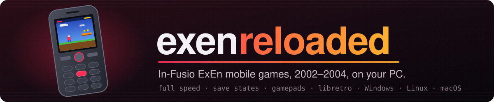

**Play In-Fusio ExEn mobile phone games on your PC, at full speed.**

[](https://github.com/zdiemer/exen-reloaded/releases/latest)
[](https://github.com/zdiemer/exen-reloaded/actions/workflows/ci.yml)
[](https://github.com/zdiemer/exen-reloaded/releases)
[](https://github.com/zdiemer/exen-reloaded-compat)
[](#download--run)
[](docs/LIBRETRO.md)
[](LICENSE)

</div>

ExEn ("Execution Engine") was In-Fusio's games platform for European feature phones in
2002–2004, on handsets from Panasonic, Sagem, Philips, Alcatel and Trium. Games shipped as `.exn`
files: a compact Java-like bytecode program plus palettised images, tile maps and melodies. Some
were original, many were licensed: Crash Bandicoot, Spyro, Banjo-Kazooie, Tomb Raider, Star Wars,
Worms, MotoGP, Age of Empires.

exen-reloaded is a from-scratch, portable reimplementation of the ExEn virtual machine and
platform. It runs every game in the test collection, with sound, save states, gamepads and a
libretro core, on Windows, Linux and macOS.

<table>
  <tr>
    <td align="center">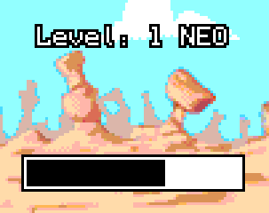<br><sub><b>Crash Bandicoot</b> · <a href="docs/media/crash.mp4">with sound</a></sub></td>
    <td align="center">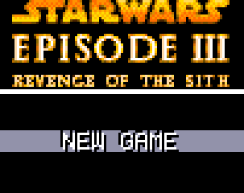<br><sub><b>Star Wars: Episode III</b> · <a href="docs/media/starwars.mp4">with sound</a></sub></td>
  </tr>
  <tr>
    <td align="center">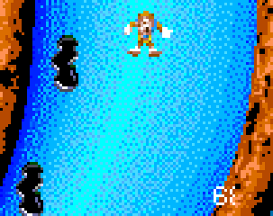<br><sub><b>Banjo-Kazooie: Grunty's Revenge Missions</b> · <a href="docs/media/banjo.mp4">with sound</a></sub></td>
    <td align="center">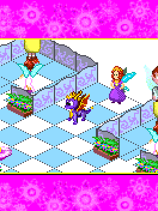<br><sub><b>Spyro</b> · <a href="docs/media/spyro.mp4">with sound</a></sub></td>
  </tr>
</table>

<table>
  <tr>
    <td align="center">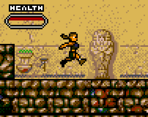<br><sub><b>Tomb Raider</b></sub></td>
    <td align="center">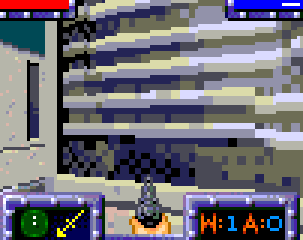<br><sub><b>Mutant Alert</b> (raycaster)</sub></td>
    <td align="center">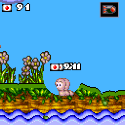<br><sub><b>Worms</b></sub></td>
  </tr>
  <tr>
    <td align="center">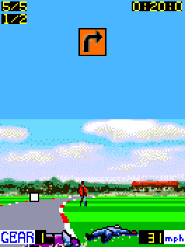<br><sub><b>MotoGP</b></sub></td>
    <td align="center">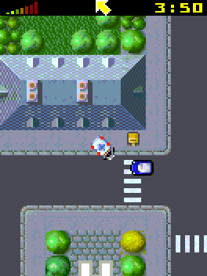<br><sub><b>Midtown Madness 3</b></sub></td>
    <td align="center">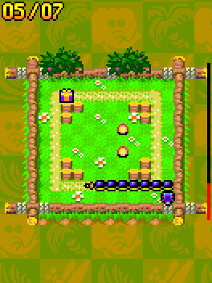<br><sub><b>Crazy Cobra 2</b></sub></td>
  </tr>
</table>

## Why

Until now the only way to run these games was In-Fusio's own SDK simulator, `gensimu.exe`, a
2003 Win32 debug build. It busy-waits (a CPU core near 100% while sitting in a menu), converts
every pixel through floating point on every frame, runs games far below the speed they ask for,
and crashes in others. exen-reloaded sleeps between frames, runs each game at its own timer
rate, and has run every game it has been given so far.

<div align="center">
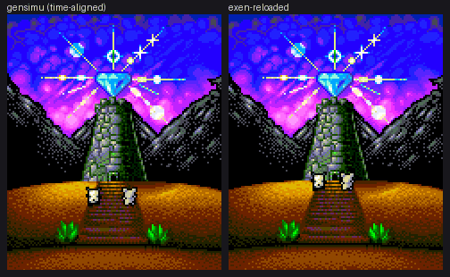<br>
<sub><b>Panko</b>, time-aligned: the 2003 simulator (left) stops with <i>An internal error has occurred</i>; exen-reloaded (right) plays on. <a href="docs/media/compare-panko.mp4">Full clip</a>.</sub>
</div>

## Download & run

1. Download the archive for your system from the
   [Releases page](https://github.com/zdiemer/exen-reloaded/releases/latest) and unpack it.
2. Run a game: `exen-reloaded game.exn` (on Windows you can also drag a `.exn` onto
   `exen-reloaded.exe`).

The archive contains the app, the headless runner `exen-run`, the libretro core (`libretro/`),
In-Fusio's original simulator `gensimu.exe`, which exen-reloaded reads the ExEn framework
from, and a General MIDI SoundFont (`soundfont/`) for the melodies (see [Sound](#sound)). Keep
`gensimu.exe` (and the `flash/` and `soundfont/` folders) beside the app. No games are
included; supply your own `.exn` files.

Each game opens at the size of the handset it was made for (from a built-in database of known
games, else 132x176).

### Command-line options

```
exen-reloaded [options] game.exn
  --scale N         window scale (default 4)
  --size WxH        handset screen (default: from the game database)
  --fullscreen      start fullscreen (F11 toggles)
  --mute, --volume N
  --voice V         melody voice: ringtone (default) or gm (General MIDI)
  --soundfont PATH  General MIDI SoundFont, if not soundfont/TimGM6mb.sf2 beside the app
  --sms MODE        server (default), delivered or offline; see SMS below
  --keys-config PATH, --print-bindings
  --sim PATH        gensimu.exe, if it is not beside the app
```

### Hotkeys

| Action | Key |
|---|---|
| Save state / load state | F5 / F8 |
| Previous / next state slot (0-9) | F6 / F7 |
| Mute | M |
| Melody voice (ring tone / General MIDI) | V |
| Fullscreen | F11 |

## Controls

The SDL3 frontend (`exen-reloaded game.exn`) maps the keyboard and any number of gamepads onto
the phone's keypad. Games were written for a phone: most move with 2/4/6/8 and fire or select
with 5 or OK, and some use 1/3/7/9 for diagonals. The defaults keep the original simulator's
keys (arrows = 2/4/6/8, numpad = keypad, Enter = OK, Esc = clear) and add the following:

| Phone key | Keyboard | Gamepad |
|---|---|---|
| 2 / 4 / 6 / 8 (up / left / right / down) | arrows, W A D S, `2 4 6 8`, numpad 8 4 6 2 | d-pad, left stick |
| 5 (fire / select) | Space, `5`, numpad 5 | A (bottom face button) |
| 1 / 3 | Q / E, `1 3`, numpad 7 / 9 | LB / RB |
| 7 / 9 | Z / C, `7 9`, numpad 1 / 3 | LT / RT |
| 0 | X, `0`, numpad 0 | stick clicks |
| * / # | `[` / `]`, numpad * / numpad / | X / Y (left / top face buttons) |
| OK / select (soft key, code -8) | Enter, numpad Enter | Start |
| Clear / back (soft key, code -7) | Esc, Backspace | B (right face button), Back |

The numpad follows the phone layout, so numpad 7 is phone 1. Hotkeys: M mutes, V switches the
melody voice (see [Sound](#sound)), F11 toggles fullscreen, F5 / F8 save / load a state, F6 / F7 pick the state slot (0-9). Keys held on several devices at once count as one press. Auto-repeat is ignored, as
in the original. Gamepads can be plugged in and out while a game runs.

To remap, edit `keys.ini`. It is written with the defaults on first run, beside the program, or
in the per-user data directory if the program's directory is not writable (for example
`%APPDATA%\exen-reloaded\exen-reloaded\` on Windows or `~/.local/share/exen-reloaded/exen-reloaded/`
on Linux). `--keys-config PATH` uses another file, and `--print-bindings` prints the controls
in effect. Each line binds a phone key (`0`-`9`, `star`, `pound`, `ok`, `clear`, or the joypad codes
`pad-up`, `pad-down`, `pad-left`, `pad-right`, which the original never sends) to SDL key names
or gamepad inputs:

```ini
; comments start with ; or #
[keyboard]
5 = Space, Left Ctrl, Keypad 5
ok = Return, Right Shift
up = Up, W

[gamepad]
stick-press = 50
stick-release = 35
5 = south
ok = start, west
2 = dpup, lefty-
```

`up`, `down`, `left`, `right` and `fire` are aliases for 2, 8, 4, 6 and 5. Gamepad face buttons
are named by position (`south`, `east`, `west`, `north`; SDL's `a`, `b`, `x`, `y` also work),
stick and trigger directions are `leftx-`, `lefty+`, `righttrigger` and so on, and
`stick-press` / `stick-release` are the percentages of travel that press and release a key.
A section in the file replaces the defaults for that device; a missing section keeps them.
Invalid entries are logged and skipped. The file's header comment lists every name.

## Saves and save states

Games keep their high scores and progress in the phone's EEPROM (`Gamelet.saveCtx`). The SDL
frontend keeps one 2048-byte image per game in `saves/<game>.eep` and writes it every time the
game saves, as the original writes `flash/EEPROM.DAT`. A game seen for the first time starts from
the settings in the simulator's `flash/eeprom.dat` (nickname, currency, SMS prices) with an empty
save record.

Save states capture the whole machine. F5 saves to the current slot, F8 loads it, F6 / F7 select
the slot; the window title shows what happened. Slots are files
`states/<game>/slot0.exst` .. `slot9.exst`. A state belongs to one game file and one
`gensimu.exe`; loading one into anything else is refused. A state includes the EEPROM as it was
when the state was saved, so loading an older state also brings back its saves.

Both directories live beside the program, or in the per-user data directory (as `keys.ini`
above). `<game>` is the title from the game database, else the CRC-32 of the `.exn` file.

The headless runner can test both: `exen-run --eeprom-out FILE` writes the EEPROM back,
`--save-at N FILE` and `--load FILE` save and resume states, and `--selftest-state` checks that
a state round trip reproduces the same frames, audio and final state.

## Sound

ExEn games play one melody at a time, and most keep their music for the title screen and
between levels: a theme of 10-35 seconds (Crash Bandicoot 21 s, Pikubi 34 s, Jungle Run 15 s),
then short jingles and effects during play. Some games have no music at all (Spyro,
Banjo-Kazooie) or only single-note blips (Tomb Raider). That is how the games were written, not
something missing here.

Games play monophonic melodies (`Gamelet.playMelody`), which the core sequences exactly as the
original simulator did and synthesises itself, so every frontend sounds the same. There are two
voices:

- **Ring tone** (default): a band-limited square wave, close to what a 2003 handset played.
- **General MIDI (like the 2003 simulator)**: what the original simulator sounded like. It sent
  the notes to Windows' General MIDI synth (the Microsoft GS Wavetable synth): the acoustic
  grand piano at a fixed velocity, unless a melody picks another instrument or the drum kit.
  This voice sends the same MIDI events, with the same timing, to a General MIDI SoundFont,
  played by [TinySoundFont](vendor/tinysoundfont/PROVENANCE.md). The releases ship
  `TimGM6mb.sf2` (5.7 MiB, GPL-2; [provenance and licence](vendor/soundfont/PROVENANCE.md)), a
  complete GM bank; any other GM SoundFont 2 file works too. Without a SoundFont the voice falls
  back to a procedural approximation of the GM piano, so it still sounds like a piano.

The SDL frontend starts with `--voice ringtone` or `--voice gm` and switches with V while
playing (the window title shows the voice for a moment); `--mute` / M and `--volume N` set the
level. It loads the SoundFont from `--soundfont PATH`, else `soundfont/TimGM6mb.sf2` or
`TimGM6mb.sf2` beside the app (in a source tree, `vendor/soundfont/`). The libretro core has the
option "Melody voice" and reads `TimGM6mb.sf2` from the system directory. The switch crossfades
over a few milliseconds and never changes the melody's timing. The voice is a player setting:
save states do not store it. The SoundFont's sounding notes are in save states and restore
exactly (rewind and run-ahead included) when the same SoundFont is loaded; with another
SoundFont, or none, they restart at the current note. `exen-run --voice gm --wav out.wav
game.exn` renders a game's audio with the GM voice (`--soundfont PATH` picks the SoundFont).

## SMS

Most games send SMS to In-Fusio's server, which is long gone: scores for a world ranking,
ranking updates, "Your opinion" votes, pay-per-use continues, unlocks and downloads of extra
content, and restores of what was bought. The original simulator forwarded them to a separate
In-Fusio PC tool. exen-reloaded mocks that server instead ([docs/re/SMS.md](docs/re/SMS.md)):

- **server** (default): every SMS is reported as sent, and requests that expect an answer get
  the most generous valid one about two seconds later: a continue is granted, an unlock or a
  download is granted, a score is ranked. Rankings and vote results hold only what you sent
  (your own scores, your own votes); nothing is made up.
- **delivered**: reported as sent, never answered (the simulator with its SMS link off).
  Continues still work; games waiting for an answer wait until you cancel.
- **offline**: reported as not sent, as with no network; games show their "problem when sending
  the SMS" screen.

The SDL frontend takes `--sms server|delivered|offline` (and dates rankings with today's date),
the libretro core has the option "SMS", and `exen-run --sms MODE --sms-log` prints the decoded
traffic. The server's records and an answer in flight are part of save states; the mode is not.

## libretro core

exen-reloaded also runs as a libretro core in RetroArch and other frontends. Copy `gensimu.exe`
(and `flash/eeprom.dat`, and `TimGM6mb.sf2` for the General MIDI voice) into the frontend's
system directory and load a `.exn`. It supports save
files (the phone's EEPROM), save states, rewind, run-ahead, and core options for the screen
size, sound, melody voice and SMS. See [docs/LIBRETRO.md](docs/LIBRETRO.md).

## Compatibility

All 47 games in the test collection run and respond to input: they reach gameplay without the VM
stopping. Per-game status, with a screenshot and a clip of each run, is tracked in
[exen-reloaded-compat](https://github.com/zdiemer/exen-reloaded-compat), regenerated by the
headless harness (`tools/harness/compat.py`). Side-by-side recordings against the original
simulator are made with `tools/compare/compare.py`.

## How it works

ExEn games are bytecode for a small Java-like VM. The ExEn framework (`exen.Gamelet`,
`exen.Graphics`, `exen.Sprite`, `exen.PlayField`, ...) is bytecode for that same VM, sitting on
185 native functions for drawing, images, tile maps, timers, keys, melodies, SMS and persistent
storage. exen-reloaded implements the VM and every one of those natives in portable C, and runs
the framework bytecode taken from the original simulator, so the framework behaves exactly as
In-Fusio wrote it. Where the original was buggy and no game depends on it, the bug is fixed and
documented.

Everything was reverse-engineered from the original simulator and the games themselves:

- [`docs/FORMAT.md`](docs/FORMAT.md): the `.exn` container
- [`docs/re/CVP.md`](docs/re/CVP.md): the prelinked class format and name hashes
- [`docs/re/OPCODES.md`](docs/re/OPCODES.md): the instruction set and execution model
- [`docs/re/NATIVES.md`](docs/re/NATIVES.md): every native, the porting layer, timing
- [`docs/re/CODECS.md`](docs/re/CODECS.md): In-Fusio's five image codecs
- [`docs/re/SMS.md`](docs/re/SMS.md): the SMS protocol

The original simulator is vendored, unmodified, in
[`vendor/gensimu/`](vendor/gensimu/PROVENANCE.md) for preservation and as the reference
behaviour. It is abandoned freeware.

## Building from source

```sh
cmake -S . -B build -G Ninja -DEXEN_BUILD_TESTS=ON -DEXEN_BUILD_LIBRETRO=ON
cmake --build build
ctest --test-dir build --output-on-failure
build/exen-reloaded game.exn
```

Needs CMake 3.20+ and a C11 compiler. SDL3 is used if installed, otherwise fetched and built.
The core (`src/core/`) is plain C with no OS or SDL dependency; the frontends are `src/sdl/` (the
app), `src/libretro/` and `src/cli/` (`exen-run`, the headless runner the harness uses).
Contributor notes are in [`AGENTS.md`](AGENTS.md); work is tracked in
[issues](https://github.com/zdiemer/exen-reloaded/issues).

## Legal

exen-reloaded is an independent reimplementation written for interoperability and game
preservation. It is not affiliated with In-Fusio. ExEn and the game titles are trademarks of
their respective owners.

exen-reloaded's own code is free software under the **GNU GPL v2** (see [`LICENSE`](LICENSE)).
Two parts of the repository are not covered by it and keep their own terms:

- `vendor/gensimu/`: In-Fusio's original EXEN-V2 simulator, abandoned freeware, redistributed
  unmodified for preservation (see its [provenance note](vendor/gensimu/PROVENANCE.md)).
- `src/libretro/libretro.h`: the libretro API header, under its own permissive licence.

No games are included.
